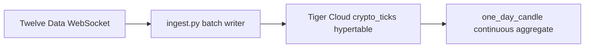

# tiger-findata

Real-time financial data pipeline for [Global Hack Week: Ingest real-time financial data into Tiger Cloud](https://www.mlh.com/events/global-hack-week-open-source-90/challenges/01a11b64-a4cd-bf31-7f19-8f2f8904f69d/submissions/new).

Streams live prices from [Twelve Data](https://twelvedata.com) over WebSocket and batch-inserts into a `crypto_ticks` hypertable on [Tiger Cloud](https://www.tigerdata.com/docs/learn/tutorials/ingest-real-time-financial-data).

## Architecture



## Prerequisites

- Tiger Cloud TimescaleDB service (DEV)
- [Twelve Data](https://twelvedata.com/pricing) API key (free tier works)
- Python 3.10+

## Setup

```bash
cd tiger-findata
python3 -m venv .venv
source .venv/bin/activate
pip install -r requirements.txt
cp .env.example .env
# Edit .env with DATABASE_URL and TWELVE_DATA_API_KEY
```

Apply schema (if not already on your service):

```bash
psql "$DATABASE_URL" -f sql/001_schema.sql
```

## Run the pipeline

```bash
python ingest.py
```

You should see `Current batch size:` climbing, then `Batch insert #1` after 100 ticks (default).

Verify:

```bash
python verify.py
```

Optional daily OHLCV aggregate (after data exists):

```bash
psql "$DATABASE_URL" -f sql/002_continuous_aggregate.sql
```

## MLH submission

Submit a **screenshot** of the terminal showing batch inserts and/or `verify.py` output, plus a **link** to this repo or Tiger Console Explorer showing `crypto_ticks`.

Tutorial reference: [Ingest real-time financial data](https://www.tigerdata.com/docs/learn/tutorials/ingest-real-time-financial-data).
